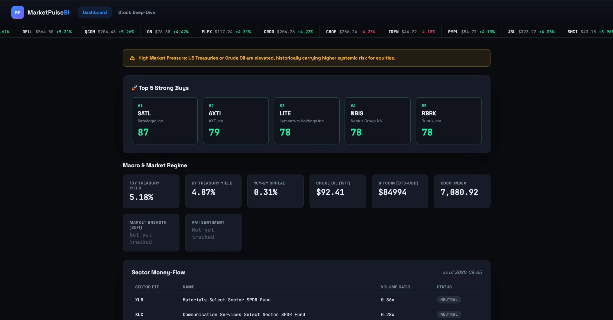
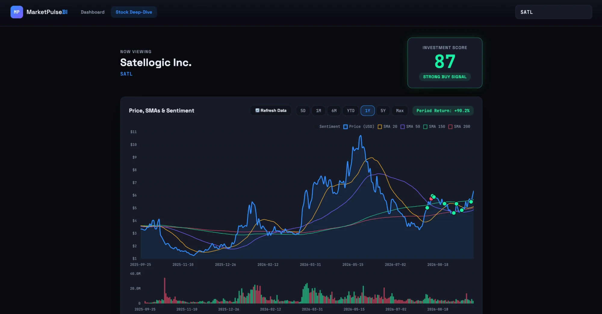
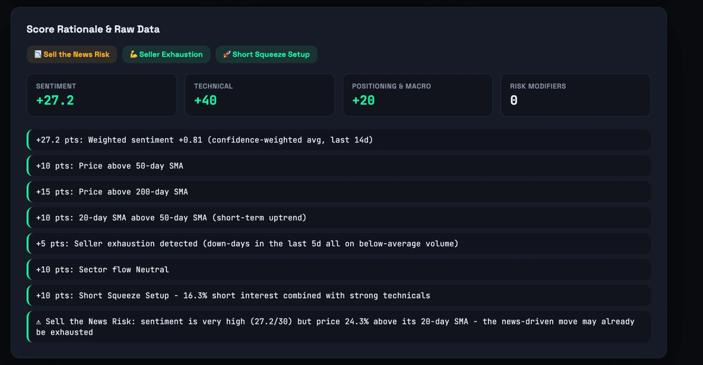
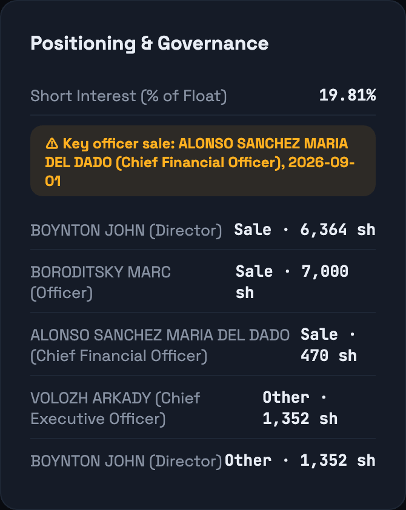
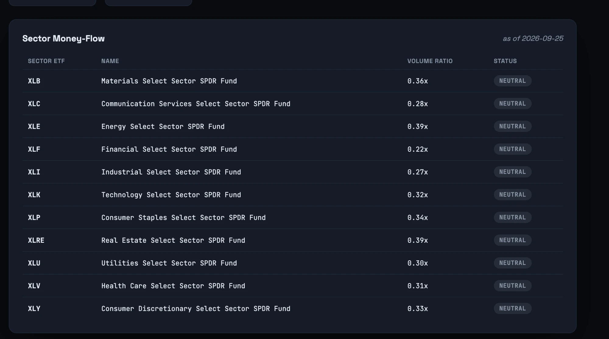
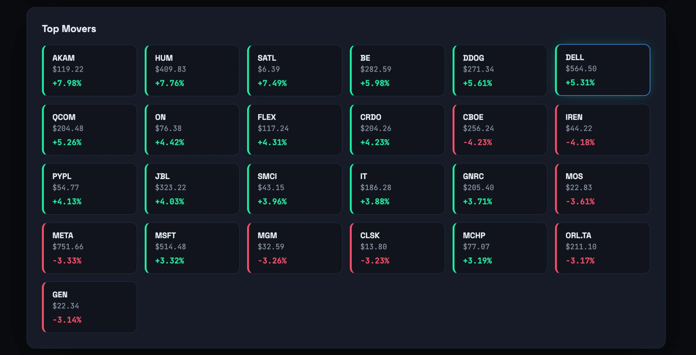
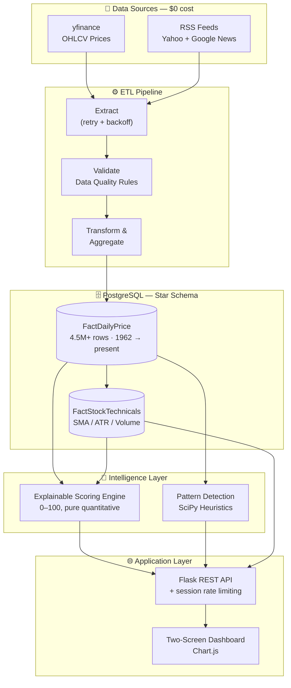
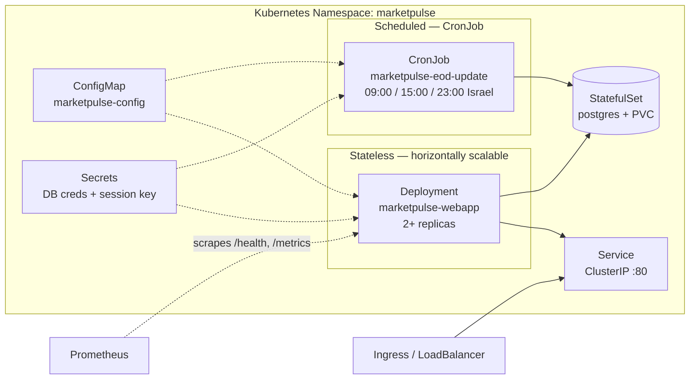

# MarketPulse BI

### An AI-Powered Financial Decision Support System

*Explainable, fully quantitative stock scoring — built on a self-hosted data pipeline processing 4.5M+ historical price points across 560 tickers, at $0 infrastructure cost.*

[](https://www.python.org/)
[](https://flask.palletsprojects.com/)
[](https://www.postgresql.org/)
[](https://www.sqlalchemy.org/)
[](https://www.chartjs.org/)
[](#testing)
[](#data-engineering-at-scale)

---

## Philosophy

Retail investors don't lack data — they lack **synthesis**. Institutional desks fuse price action, breaking news, sector rotation, insider activity, and short-interest positioning into a single call in seconds; everyone else is left context-switching between six browser tabs.

MarketPulse BI is a **decision support system**, not a trading bot. It doesn't predict prices or execute trades — it does the tedious cross-referencing a human analyst would do, transparently, and hands back a single 0–100 score **with its full reasoning attached**. Every point is traceable to a named rule. Nothing is a black box.

---

## Screenshots

| Market Dashboard | Stock Deep-Dive |
|---|---|
|  |  |
| Macro regime (10Y/2Y yields, WTI crude), sector money-flow across all 11 SPDRs, and a top-movers grid — the morning-briefing view. | Price chart with SMA overlays, a volume sub-chart, the pillar-by-pillar score rationale, and the latest company headlines. |

| Score Rationale Panel | Positioning & Governance |
|---|---|
|  |  |
| The full audit trail behind the Investment Score — every rule that fired, in plain English, with its point contribution. | Short interest, insider Form 4 filings, and a flagged CEO/CFO sale — the governance signals a fundamentals desk would check by hand. |

### Market Intelligence, Not Just a Stock Screener

| Sector Money-Flow | Top Movers |
|---|---|
|  |  |
| Accumulation/Distribution/Neutral status for all 11 sector SPDRs, ranked by volume ratio — where institutional money is rotating *today*. | The day's largest movers across the full watchlist, ranked by absolute % change, color-coded and one click from a full deep-dive. |

---

## Architecture



**Star schema**: `DimAsset`, `DimDate`, `FactDailyPrice`, `FactStockTechnicals`, `FactSectorVolume`, `MacroIndicators`, plus governance tables (`InsiderTransactions`, `StockEnrichmentCache`) and operational logging (`PipelineExecutionLog`, `DataQualityResults`). Full column-level definitions in [`db/migrations/`](db/migrations/). (`FactSentiment` and the `vw_*Sentiment*` BI views are a frozen legacy: nothing writes to them any more, they only hold history from before sentiment was removed.)

---

## Core Features

### 🧮 Explainable AI Scoring — not a black box

The Investment Score (v2) is **100% quantitative: no news, no sentiment**. It is a **diagnostic snapshot of current technical and sector alignment, not a forecast and not investment advice** (a point-in-time backtest of the earlier, sentiment-based version found no predictive power; v2 makes no claim to have changed that). Three pillars sum to exactly 100, applied identically to every stock:

| Pillar | Max | What it measures |
|---|---|---|
| **1. Trend & Moving Averages** | 45 | Price vs SMA-20 (10), SMA-50 (10), SMA-200 (10), and SMA-50 vs SMA-200 alignment (15) |
| **2. Momentum & RSI-14 regime** | 30 | Healthy bullish RSI (about 55-65) scores highest, neutral RSI moderate, oversold-and-recovering is rewarded, overbought (above 70) is progressively penalised so stretched stocks cannot reach 80+ |
| **3. Sector & Risk/Short profile** | 25 | Sector money-flow (10) + sector 20-day performance vs the S&P 500 (5) + short interest (6) + volatility vs its own history (4) |
| **Modifier: CEO/CFO insider activity** | −5 / 0 / +5 | Net selling over the last 90 days is exactly **−5.0** (red *Insider Selling* badge), net buying exactly **+5.0** (green *Insider Buying* badge), none 0; added to the pillars and clamped to 0-100. Only open-market sales and purchases by the CEO or CFO count (not grants, gifts or option exercises). Badge and points come from one value, so they cannot disagree. |

**Graded, not binary.** Each moving-average rule is a smooth ramp: half the points when price sits exactly on the average, full a "band" above it, zero a band below. A stock with no edge lands mid-scale in every pillar (a perfectly neutral stock scores about 50-58), and missing data counts as neutral and says so, never as bad.

Every rule appends a line to the audit trail, grouped by pillar, with points earned out of points possible:

```
Trend & Moving Averages: 31.4 / 45 pts
  7.3 / 10 pts: Price +2.1% vs 20-day SMA (half points on the average, full at +3%, zero at -3%)
  ...
Momentum & RSI-14: 30.0 / 30 pts
  30.0 / 30 pts: RSI-14 is 61.2: healthy bullish momentum range (45-65)
```

Bands shown in the UI are diagnostic labels: **70+ Strong Signal, 45-69 Neutral / Mixed, below 45 Weak Signal**. `scripts/score_backtest.py` replays the exact v2 formula at every month-end since 2005 (see `reports/`), and `scripts/evaluate_score_ic.py` (run weekly) measures whether the score has actually preceded outperformance, at 5, 20 and 60 trading days with per-pillar attribution; it reports "INSUFFICIENT DATA" rather than a number until enough history exists.

### 📊 Data Engineering at Scale

- **560 tickers** — a curated personal watchlist merged with the full S&P 500 constituent list (scraped live from Wikipedia) and all 11 Sector SPDR ETFs.
- **4.5M+ price rows**, backfilled with `yfinance`'s full `period=max` history — some tickers reach back to **1962**.
- Idempotent upserts throughout (`ON CONFLICT` keyed on natural keys) — the entire pipeline can be re-run against the same day's data with zero duplication.
- A confirmed, measured performance fix: the dashboard's "Top Movers" query dropped from **~1.85s to ~90ms** by filtering to a recent date window *before* applying a window function, instead of scanning the full multi-million-row table on every page load.
- Exchange-aware data hygiene: yfinance returns phantom stale-close rows for non-U.S. markets on days the source calendar doesn't recognize as holidays (e.g. the Tel Aviv Stock Exchange's Friday/Saturday weekend) — these are filtered at ingestion so they can't quietly dilute rolling volume/volatility averages.

### 🔄 Live Refresh & Session-Scoped Rate Limiting

A "Refresh Data" button on the deep-dive screen triggers an on-demand, single-ticker re-fetch (price, news, technicals) — deliberately scoped to just that ticker, not a full pipeline run. Protected by an in-session rate limiter:

- **5 refreshes per rolling hour**, tracked per browser session via a signed cookie — no database table, no user accounts, no external dependency.
- A clean `429` response with a human-readable retry estimate when the budget is exhausted, surfaced in the UI as a dismissible warning rather than a broken button.

### 🔍 Heuristic Pattern Detection

A lightweight `scipy.signal.find_peaks`-based module scans recent price action for two classic chart silhouettes:

- **Head and Shoulders** — three peaks with a taller middle peak and near-symmetric shoulders.
- **Cup and Handle** — a rounded recovery back near a prior high, followed by a shallow pullback.

These render as a dashed "Technical Observation" badge — a nudge to look closer in a real charting tool, **never a scoring input**. This separation is deliberate and enforced by tests: the Investment Score is verified byte-for-byte identical whether or not a pattern hint fires.

### 📈 Momentum & Fundamentals Snapshot

The stock deep-dive also shows **RSI (14-day, Wilder)** in the Technical & Risk panel — green "Oversold" below 30, red "Overbought" above 70 — and a **Fundamentals** panel with trailing P/E, market cap and beta. RSI is computed nightly with the other technicals from price history already in the database; the three fundamentals come from the same `yfinance` `Ticker.info` call already used for short interest and are cached for 24 hours (`n/a` means Yahoo has no value, e.g. no P/E for a loss-making company; `—` means nothing has been fetched yet). **None of these feed the Investment Score** — like the pattern hints, they are context for the reader, not a scoring input.

The price chart opens with **only the price line** visible; SMA 20/50/150/200 stay in the legend (struck through) and toggle on with a click. Your choices persist while you switch timeframes or tickers.

---

## Tech Stack

| Layer | Technology |
|---|---|
| Language | Python 3.11 |
| Web Framework | Flask 3.0 |
| Database | PostgreSQL 16 (star schema, via SQLAlchemy 2.0) |
| Market Data | `yfinance` |
| News | Yahoo Finance & Google News RSS (`feedparser`) |
| Scientific Computing | `scipy`, `pandas`, `numpy` |
| Frontend | Vanilla JS + Chart.js (no build step) |
| Testing | `pytest` |
| Containerization *(images build in CI; not yet deployed)* | Docker (multi-stage, non-root), Kubernetes |

---

## Getting Started

### Prerequisites

- Python 3.11+ (newer `yfinance` needs `curl_cffi`, which has no wheels for 3.9)
- PostgreSQL 16 running locally (`brew install postgresql@16` on macOS)

### 1. Clone & set up the environment

```bash
git clone https://github.com/Liormym/MarketPulse-BI.git
cd MarketPulse-BI

python3.11 -m venv .venv
source .venv/bin/activate
pip install -r requirements-dev.txt   # runtime deps + pytest; the images use requirements.txt only

cp .env.example .env   # edit if your local Postgres credentials differ
```

### 2. Initialize the database

```bash
python scripts/apply_migrations.py     # versioned schema, tracked in schema_migrations
python scripts/seed_dimensions.py      # DimDate + DimAsset from config/watchlist.yaml
```

### 3. (Optional) Expand to the full S&P 500 universe

```bash
python scripts/fetch_sp500_constituents.py   # merges the S&P 500 into the watchlist
python scripts/seed_dimensions.py            # re-seed with the expanded list
```

### 4. Backfill historical data

```bash
# Full available history (recommended — powers the 5Y/Max chart views)
PYTHONPATH=src python scripts/backfill_historical_prices.py --period max

# Derived tables, computed from the price history you just pulled (no new API calls)
PYTHONPATH=src python scripts/compute_stock_technicals.py
PYTHONPATH=src python scripts/compute_sector_flows.py
PYTHONPATH=src python scripts/fetch_macro_indicators.py
```

### 5. Run the data pipeline (prices and news)

```bash
PYTHONPATH=src python -m marketpulse.pipeline
```

### 6. Launch the web app

```bash
python webapp/app.py
```

Visit **http://localhost:5050** — the Market Dashboard loads at `/`, and any ticker's deep-dive view is at `/stock/<TICKER>`.

---

## Daily Automation (End-of-Day Pipeline)

A quantitative system is only as trustworthy as its most stale input. Sector flows, technicals, and Investment Scores all depend on the day's price data being fresh — if any one of those steps runs out of order, or on its own schedule disconnected from the others, the dashboard can end up telling two different stories about "today" (exactly what the freshness badges in the Macro and Sector panels are designed to catch).

`scripts/run_daily_update.py` is the single entry point that runs the full refresh in the dependency order that actually matters:

1. **Fetch macro indicators** (`fetch_macro_indicators.py`) — yields, oil, Bitcoin, KOSPI, S&P 500, NASDAQ, RSP
2. **Fetch fresh prices & news** (`python -m marketpulse.pipeline`) — the trailing-window daily pipeline, not the one-time full backfill
3. **Recompute technicals** (`compute_stock_technicals.py`) — SMA/ATR/gap, from step 2's prices
4. **Compute sector flows** (`compute_sector_flows.py`) — Accumulation/Distribution/Neutral, from step 2's prices
5. **Compute Investment Scores** (`compute_investment_scores.py`) — from steps 2–4's output
6. **Generate the Daily Macro Brief** (`generate_market_brief.py`) — a deterministic, rule-based 1–2 sentence market summary (index move, 10Y yield, sector leaders/laggards, oil, breadth) stored in `DailyMarketBrief` with the facts behind it; no LLM or external API. Shown at the top of the dashboard.

### How fresh is the data?

Nothing in the UI is "live" unless you ask for it. The scheduled update (09:00, 15:00 and 23:00 Israel time, daily) is the baseline: prices are the last **close**, so while the US market is open the scheduled numbers are the previous day's. On a stock page, **Refresh Data** re-fetches that one stock from Yahoo Finance at that moment (price is Yahoo's feed, delayed up to ~15 minutes while the market is open; limited to 5 per hour per visitor).

Every screen shows when its data was really fetched or computed, as a timestamp in the viewer's timezone plus a live age ("2 h 10 min ago"), taken from `DataFreshness` / `StockDataFreshness` (migration `009`): a dashboard strip with the last fully successful EOD update and the next scheduled run (and per-source times under *Details*), a badge on each dashboard section, and on every stock page a price line under the name plus a *Data Freshness* table (prices, news, technicals, fundamentals, drivers; the Investment Score is computed live on page load). A timestamp advances only after its fetch succeeded (a failed feed never makes data look fresh), and turns amber when a scheduled run has happened since (`marketpulse/schedule.py`).

Step 2 also stores each ticker's **Recent Company News**: up to 4 of the latest headlines that explicitly name the company or ticker (publisher bylines ignored, head-to-head comparisons dropped), newest first, shown as plain linked headlines with their date. News is context only: it is not an input to the Investment Score, and no sentiment score or red/green colouring is shown. There is no sentiment model anywhere in the system: FinBERT, PyTorch and Transformers were removed, which is why the Docker images are small and the cluster pods need little memory.

It stops at the first failing step rather than pressing on with partial data:

```bash
PYTHONPATH=src python scripts/run_daily_update.py
```

### Score history

Step 5 also appends every ticker's score to `FactInvestmentScoreHistory` (one row per asset per price bar, with the four pillar scores, flags, RSI and the bar's close). `FactInvestmentScore` stays the single "latest score" cache the dashboard reads; the history table is what lets you ask whether high scores actually preceded gains, measured on real scores instead of ones reconstructed afterwards. Re-running on the same bar rewrites that row rather than duplicating it. History starts on the first run after migration `006` is applied, so a meaningful forward test needs a few months to accumulate.

### Running it automatically

The full update runs **three times a day, every day: 09:00, 15:00 and 23:00 Israel time** (`marketpulse/schedule.py` is the one definition; the k8s CronJob and the dev daemon both follow it, and a test keeps them in sync). In New York time that is roughly 02:00 (after the close, writes the *final* daily bar), 08:00 (pre-market) and 16:00 (the closing bell, so that day's bar may still be provisional until the 09:00 run). Weekends are included so news and Bitcoin stay fresh. `scripts/scheduler.py` is a small daemon that triggers it for a single dev machine; each firing runs the orchestrator as a subprocess, so a failed run can't crash the daemon, and a run that overruns a slot skips it rather than overlapping.

Start it in the background and leave it running (e.g. in `tmux`/`screen`, or with `nohup`):

```bash
# tmux (recommended for a dev machine you keep logged into)
tmux new -s marketpulse-scheduler
PYTHONPATH=src python scripts/scheduler.py
# detach with Ctrl+B then D; reattach later with: tmux attach -t marketpulse-scheduler

# or nohup, if you'd rather not use tmux
PYTHONPATH=src nohup python scripts/scheduler.py > scheduler.log 2>&1 &
```

**For a production deployment, prefer `cron` (or the `k8s/eod-update-cronjob.yaml` CronJob already in this repo) over a long-lived Python daemon** — a scheduler process is one more thing that can silently die on a dev machine. The equivalent crontab entry:

```cron
0 9,15,23 * * * cd /path/to/MarketPulseAI && PYTHONPATH=src /path/to/.venv/bin/python scripts/run_daily_update.py >> /var/log/marketpulse-eod.log 2>&1
```

`0 9,15,23 * * *` reads as: minute 0 of hours 9, 15 and 23, every day (run it on a machine whose clock is set to Israel time, or use the k8s CronJob, which carries `timeZone: Asia/Jerusalem`).

---

## Testing

```bash
PYTHONPATH=src pytest                          # everything, against your local dev database
PYTHONPATH=src pytest -m "not populated_db"    # what CI runs: no backfilled market data needed
```

140 tests covering the scoring engine (every rule in isolation, plus fuzz-tested bounds), the news filter, technical indicator math (SMA/ATR/RSI), pattern detection heuristics, the rate limiter and its shared outbound limiter, production-config fail-fast, the EOD orchestrator's stop-on-failure behaviour, and idempotent-upsert integration tests against a real local Postgres instance. Five tests are marked `populated_db`: they need real backfilled prices and live Yahoo access, so CI (which only has a freshly migrated, seeded database) deselects them.

## Container Images & CI

`.github/workflows/ci.yml` runs on every push and pull request:

1. **test** — migrates and seeds a Postgres 16 service container, then runs `pytest -m "not populated_db"`.
2. **images** — builds `docker/webapp.Dockerfile` and `docker/pipeline.Dockerfile` for `linux/amd64`, smoke-tests each (runs as UID 10001 with `--network none`, the webapp boots in production mode and answers `/health`), and on pushes pushes them to GHCR as `ghcr.io/<owner>/marketpulse-{webapp,pipeline}:sha-<short>-amd64` (plus `main-amd64` on the default branch).

Both images are multi-stage, pin the Python base image by digest, and carry no ML stack (no PyTorch / Transformers / model weights), so they are small and start fast. To build locally on Apple silicon for the cluster's architecture:

```bash
docker build --platform linux/amd64 -f docker/webapp.Dockerfile -t marketpulse-webapp .
```

When bumping the Python base image, change the tag **and** digest together in both Dockerfiles — CI fails if they disagree.

---

## Repository Layout

```
src/marketpulse/       Core pipeline & domain logic
├── extract/            yfinance + RSS ingestion
├── news_relevance.py    which headlines are about which stock
├── load/                 Idempotent upserts
├── scoring.py             Explainable Investment Score engine (v2: trend, momentum, sector/risk)
├── technicals.py           SMA / ATR / volume computation
├── sector_flow.py            Sector Accumulation/Distribution classification
├── pattern_detection.py       SciPy chart-pattern heuristics
└── live_refresh.py             On-demand single-ticker refresh

webapp/                 Flask application
├── app.py               Routes & API
├── db.py                 Query layer
├── rate_limit.py           Session-scoped rate limiter
├── templates/                Dashboard & deep-dive HTML
└── static/                    CSS + Chart.js frontend

db/migrations/          Versioned SQL schema
scripts/                 One-off backfills, computations, data fixes,
                          and the daily EOD orchestrator + scheduler
tests/                    pytest suite
config/watchlist.yaml     The 560-ticker universe
```

---

## Cloud Architecture & Kubernetes Deployment

MarketPulse runs happily on a laptop, but nothing about its design is laptop-specific. Every component maps cleanly onto a standard Kubernetes workload type, and the manifests in [`k8s/`](k8s/) are real, reviewed artifacts — not aspirational diagrams. (They're not yet applied to a live cluster here, simply because Docker Desktop/minikube aren't installed on this dev machine — see [`docker-compose.yml`](docker-compose.yml) for the local container equivalent in the meantime.)



### The Flask API is a stateless `Deployment`

The rate limiter's state lives in a **signed session cookie on the client**, not in server memory (`webapp/rate_limit.py`) — so there's no sticky-session requirement, no shared cache, no leader election. Scaling from 1 replica to N is just `replicas: N` ([`k8s/webapp-deployment.yaml`](k8s/webapp-deployment.yaml)). It ships with two Kubernetes-native health checks (`webapp/app.py`):

- **`/health`** — liveness. Never touches Postgres, so a slow/unreachable database doesn't trigger a restart-loop of otherwise-healthy pods.
- **`/health/ready`** — readiness. Runs a trivial query, so a pod that *can't* reach Postgres stops receiving traffic without being killed.

### The end-of-day update maps to a single `CronJob`

| Workload | Kubernetes Kind | Schedule | Why |
|---|---|---|---|
| EOD update (`scripts/run_daily_update.py`: macro → prices/news → technicals → sector flow → scores → macro brief) | `CronJob` → `Job` → `Pod` | `0 9,15,23 * * *` in `Asia/Jerusalem` (three times a day) | One dependency-ordered run that stops at the first failed step, so no step ever computes on stale upstream data |
| `period=max` historical backfill, S&P 500 constituent refresh | one-shot `Job` (`kubectl create job --from=cronjob/...`) | On-demand | These are onboarding/rebalancing operations, not a recurring schedule — modeled honestly as one-time Jobs rather than forced into a CronJob that would mostly no-op |

Every write path (`ON CONFLICT` upserts throughout) is safe to re-run, which is precisely what makes the `CronJob → Job → Pod` model viable in the first place — a missed or doubled run on a flaky node is a non-event.

### Configuration: `ConfigMaps` and `Secrets`, kept strictly separate

[`k8s/configmap.yaml`](k8s/configmap.yaml) holds everything safe to read in plaintext (watchlist path, outbound request rate and worker counts, DB host/port, `APP_ENV`). [`k8s/externalsecrets.yaml`](k8s/externalsecrets.yaml) pulls the secrets (DB credentials, Flask session-signing key, backup bucket keys) from AWS Secrets Manager via the External Secrets Operator — no secret value is ever in Git. Every workload composes both via `envFrom`, so adding a new non-secret setting never means editing three YAML files. With `APP_ENV=production` the webapp and the EOD job refuse to start while any secret is still a placeholder.

### Built for observability

- **Structured operational logging today**: every pipeline run's stage-by-stage status and every data-quality check result land in `PipelineExecutionLog` / `DataQualityResults` (queryable directly — no external tool required to see if last night's run succeeded).
- **Kubernetes-native health surface today**: `/health` and `/health/ready` are exactly what a Prometheus `kubernetes_sd_config` or a standard liveness/readiness probe expects out of the box — no adapter needed.
- **Ready for a metrics sidecar**: the architecture doesn't fight a `postgres_exporter` (StatefulSet) or a Flask Prometheus middleware (Deployment) — both are additive, drop-in containers/decorators, not a redesign. Grafana dashboards over pipeline duration, DQ pass rate, and API latency are a natural next step once there's a cluster to point them at.

### Bringing it up

```bash
kubectl apply -k k8s/     # see k8s/README.md for prerequisites (ingress-nginx, cert-manager, ESO) and the deploy runbook
```

---

## Out of Scope

No algorithmic trading, no real-time streaming (batch/on-demand only), no Kafka/Spark, no cloud spend — the entire system runs locally at **$0** infrastructure cost.

---

<p align="center"><sub>Built as an end-to-end data engineering + applied ML portfolio project.</sub></p>
