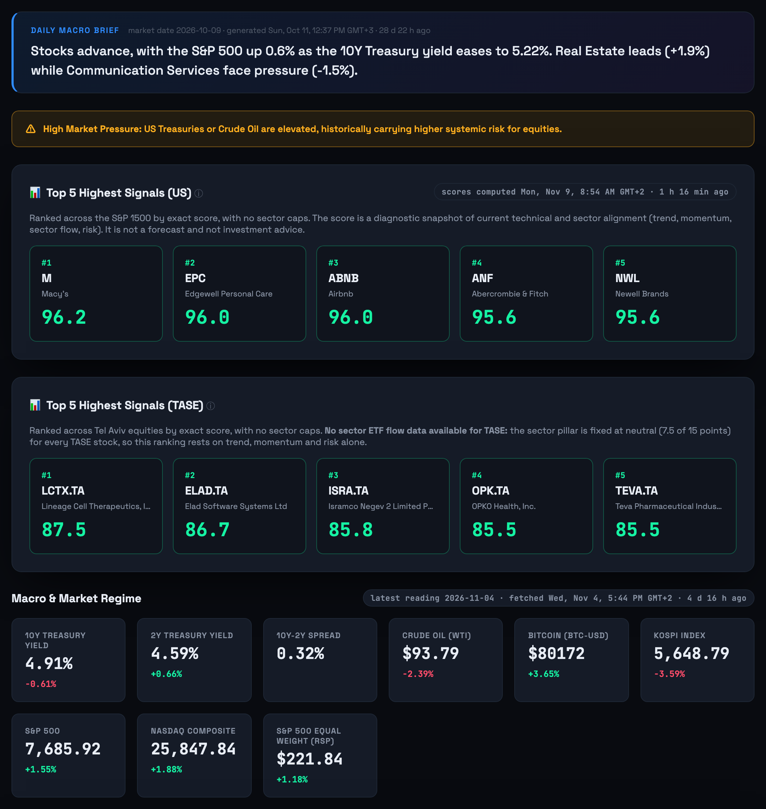
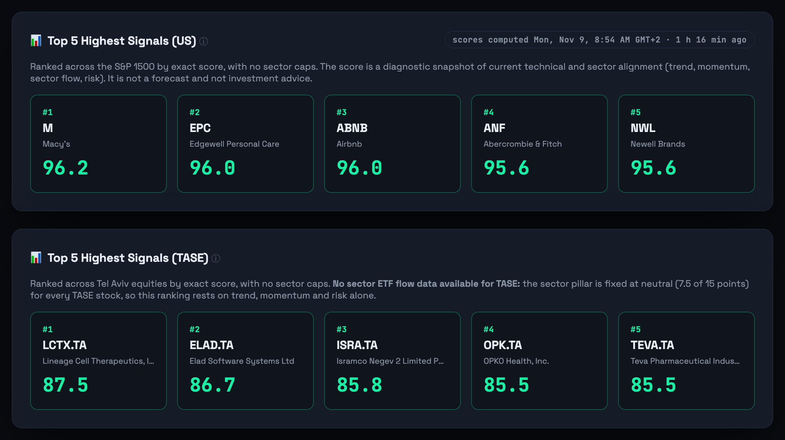
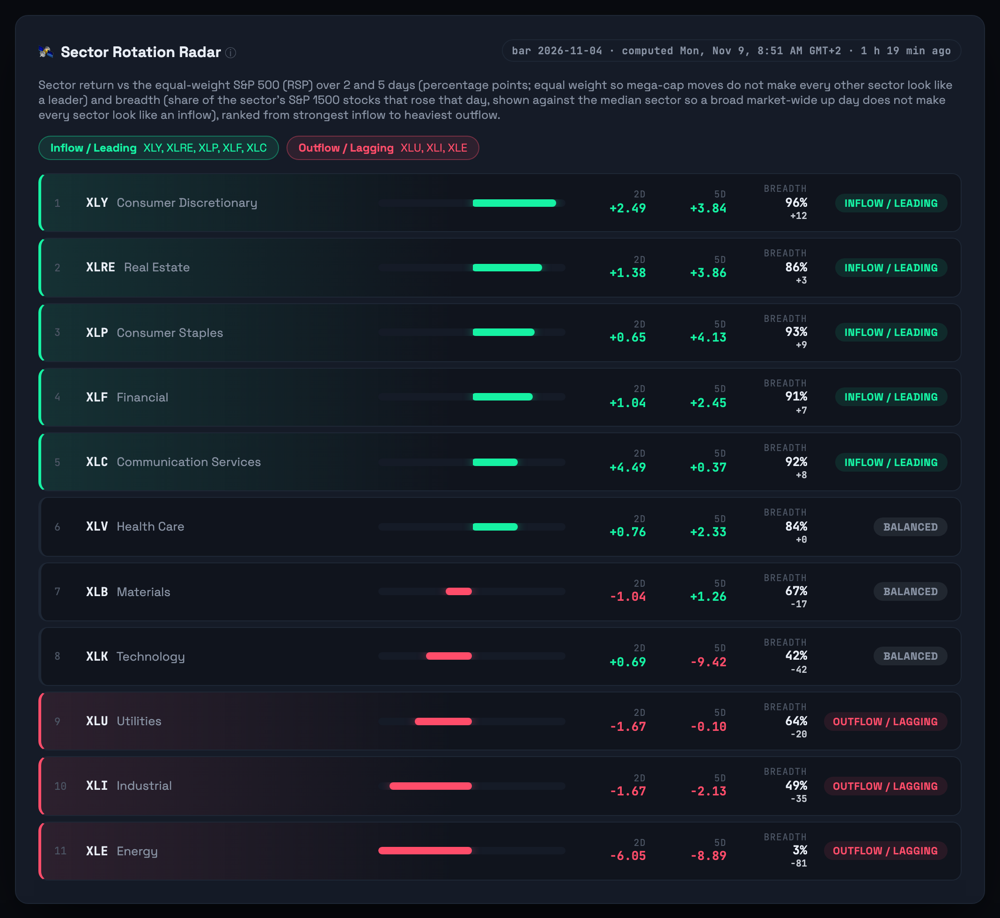
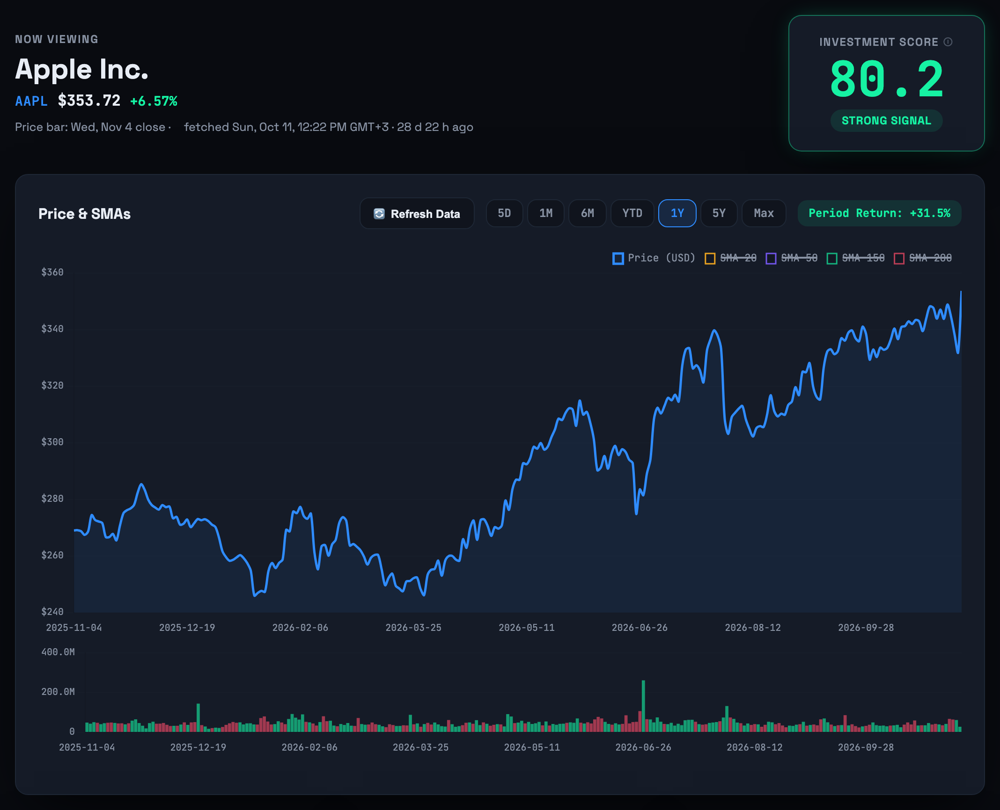
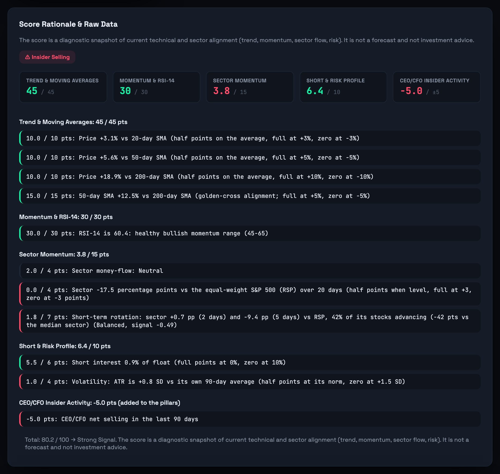
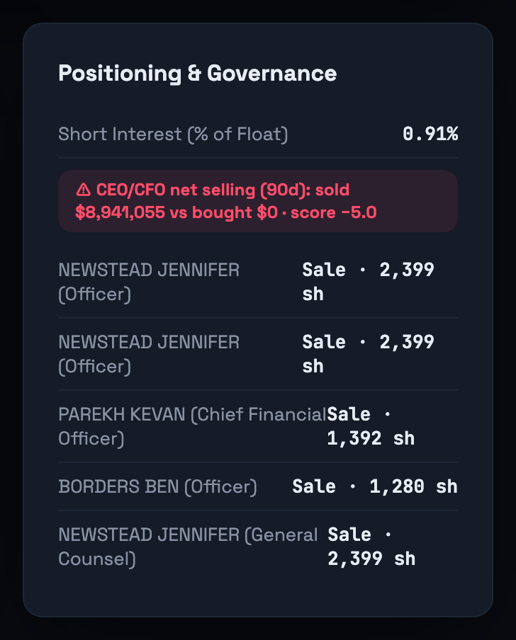
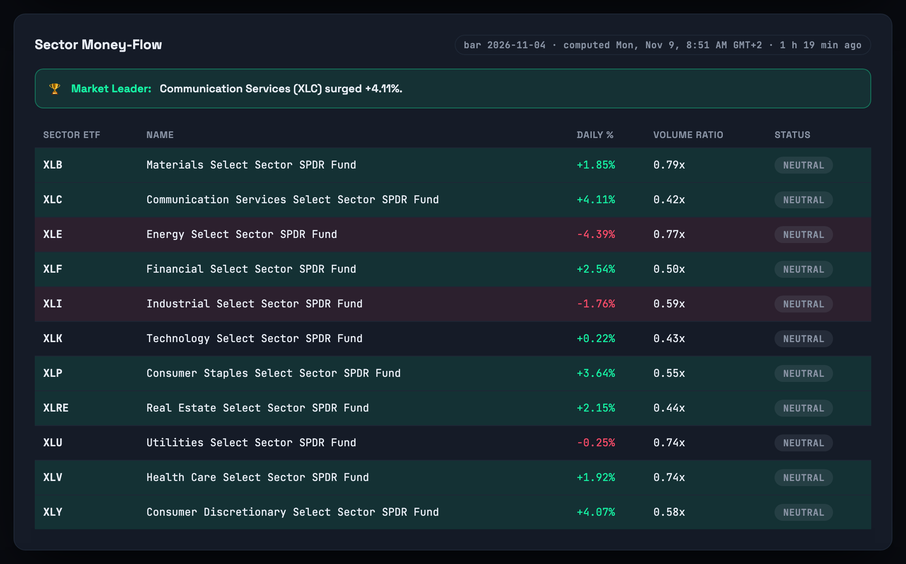
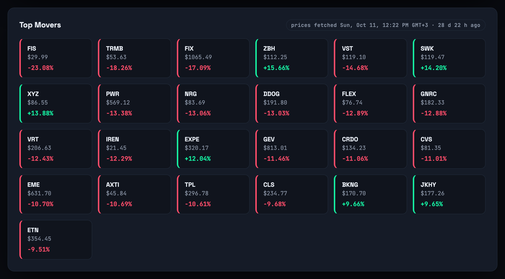
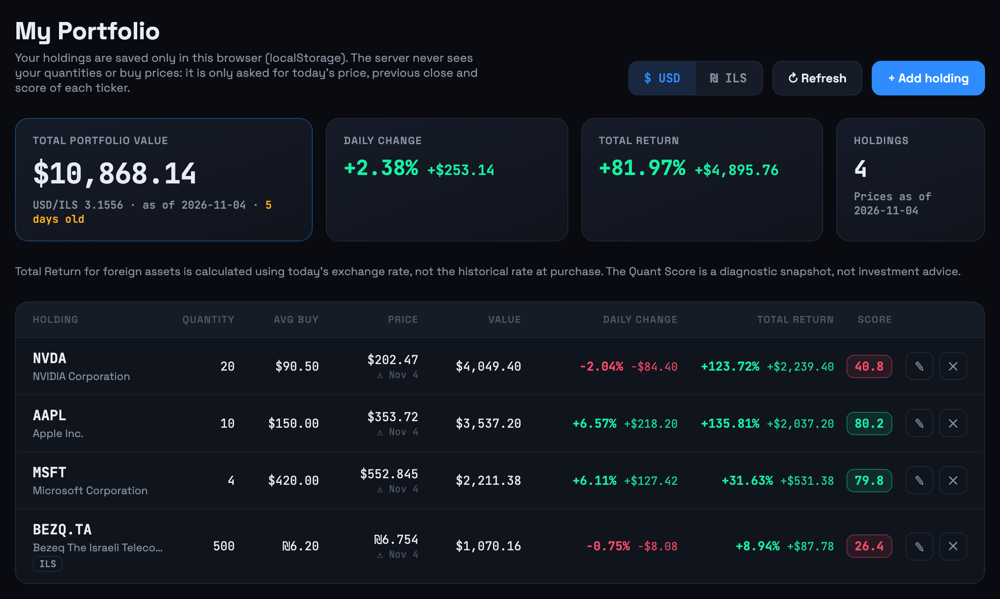

# MarketPulse BI — Marketing Assets

שני חלקים: (1) דף ייחוס של צילומי המסך של המוצר, (2) תסריטי ה-Voiceover בעברית לריל ולאינסטגרם. הכול מתאר את המערכת כפי שהיא היום: **ציון קוואנט טהור (rule-based, Score v2)** ו-**Dual-Timeframe Sector Rotation Engine מול RSP**. אין במערכת ניתוח סנטימנט, FinBERT או מודל AI, ואסור לטעון אחרת (ראו "גבולות המסר" בסוף).

---

# חלק 1: Visual Reference Sheet

Quick-reference for the nine product screenshots in `docs/images/`, for pitch decks, beta-recruitment posts and social content. All of them are captured from the running app by `marketing/promo_animation/capture_app.py docs` (the portfolio shot uses a fictional demo portfolio). Re-run it after the next data refresh so the freshness badges read current.

---

## 1. Market Dashboard

The morning-briefing view: the Daily Macro Brief, the Macro Risk Alert banner, **two separate Top 5 panels (US and TASE)** ranked by exact score with no sector caps, and the Macro & Market Regime tiles (10Y/2Y yields, WTI crude, Bitcoin, KOSPI, S&P 500, NASDAQ, RSP) each with a daily % change badge.

**Best for:** the "this looks like a real trading terminal" first impression. Opening shot material.

---

## 2. Top 5 Highest Signals (US and TASE)

The S&P 1500 and Tel Aviv leaderboards side by side. The TASE panel says it plainly: there is no sector ETF flow data for TASE, so the sector pillar is fixed at neutral (7.5 of 15 points) and the ranking rests on trend, momentum and risk.

**Best for:** the "two markets, one score" line, and for showing the product is honest about what it can and cannot see.

---

## 3. Sector Rotation Radar

All 11 sectors ranked from strongest inflow to heaviest outflow. Each row shows the sector ETF's 2-day and 5-day return vs the equal-weight S&P 500 (RSP) and its breadth (share of the sector's S&P 1500 stocks that rose, shown against the median sector). A regime (Inflow / Leading, Balanced, Outflow / Lagging) is named only when all three signals agree.

**Best for:** the hero feature. "Where is money moving, today, before a 20-day trend can show it?" It is a real-time diagnostic, not a forecast.

---

## 4. Stock Deep-Dive

Per-ticker view: price and daily change in the header, the Investment Score card with its glow colour-coded to the score band, and the price/SMA chart with the Period Return badge and timeframe selector (5D/1M/6M/YTD/1Y/5Y/Max).

**Best for:** chart depth and interactivity. Good for a screen-recording pan or a timeframe-click demo.

---

## 5. Score Rationale Panel

The full audit trail behind the Pure Quant score: every rule that fired across the three pillars (Trend & Moving Averages 45, Momentum & RSI-14 30, Sector & Risk 25) plus the CEO/CFO insider modifier (±5), each as "points earned / points possible" with a plain-English explanation. The sector pillar includes the short-term rotation line and its deduction or reward.

**Best for:** the "not a black box" pitch. The single best screenshot for explaining why the score can be trusted: it is a set of visible rules, not a model that guesses.

---

## 6. Positioning & Governance Panel

Short interest (% of float), the CEO/CFO net-selling flag with its exact score effect, and the recent insider transactions from SEC filings, the governance signals a fundamentals desk would otherwise check by hand.

**Best for:** showing the platform goes beyond price data into governance research.

---

## 7. Sector Money-Flow

The 11 sector SPDR ETFs ranked by daily % change and volume ratio, each classified Accumulation / Distribution / Neutral, with the "Daily Market Leader" banner.

**Best for:** the macro angle, paired with the Rotation Radar: money flow by volume, rotation by relative return.

---

## 8. Top Movers

Watchlist movers ranked by absolute daily % change, with a green/red edge glow and one click to each ticker's deep-dive.

**Best for:** a fast-cut B-roll shot. Lots of colour and numbers, reads as "alive" at a glance.

---

## 9. My Portfolio

The local portfolio tracker (demo holdings): total value with a USD/ILS toggle, and for every holding the daily change and total return shown as **percentage and absolute amount side by side**, plus the exact Quant Score. Holdings live only in the browser's `localStorage`; the server never sees quantities or buy prices.

**Best for:** the privacy angle ("your portfolio stays on your device") and for TASE + US users who hold both currencies.

---

# חלק 2: תסריטי Voiceover (עברית)

הנחיות בימוי באנגלית, טקסט ה-VO בעברית. טון: מקצועי, אנרגטי, בטוח, בלי הבטחות. המסר המרכזי: **זיהוי מוקדם של תנועת כסף בין סקטורים, וציון שקוף שאפשר לבדוק**.

## תסריט A: הריל המוכן (30 שניות, תואם ל-`scripts/build_promo_reel.py`)

הריל נבנה מ-10 שניות פתיח סטודיו, 15 שניות של צילומי האפליקציה, ו-5 שניות סיום. ההקלטה מונחת על הריל בלי אודיו מקורי. כתוביות בעברית מוטמעות על המסך, כי רוב הצפייה בלי קול.

| זמן | VISUAL | VO |
|---|---|---|
| 0:00–0:10 | Studio intro: "Data is abundant. Synthesis is rare.", number rush, then the risk badge. | יש המון נתונים, ומעט מאוד הבנה. בניתי מערכת שהופכת רעש שוק לתמונה אחת ברורה: לאן הכסף זז, ומה חזק עכשיו. |
| 0:10–0:13.5 | Dashboard: the separate US and TASE Top 5 panels, slow scroll. Headline: "Your entire market. One screen." | חמשת האותות החזקים ביותר, בנפרד לארצות הברית ולתל אביב. דירוג לפי ציון מדויק. |
| 0:13.5–0:18 | Sector Rotation Radar scrolling from the Inflow chips down to Energy. Headline: "Catch sector rotation early." | מנוע רוטציית סקטורים: ביומיים ובחמישה ימים, מול RSP במשקל שווה. רואים לאן הכסף זז, מוקדם. |
| 0:18–0:21.5 | Score rationale on a stock page, points lines scrolling. Headline: "Pure quant. Fully explained." | ציון קוואנט טהור. כללים, לא קופסה שחורה. כל נקודה מוסברת. |
| 0:21.5–0:25 | My Portfolio: the percentage and amount side by side, USD/ILS toggle. Headline: "Your portfolio. Your device." Caption: demo holdings. | והתיק שלך? נשאר אצלך. נשמר רק בדפדפן, לא בשרת. |
| 0:25–0:30 | Studio outro: MarketPulse BI logo and "Quantitative Decision Support System". Burned-in Hebrew caption: "בטא פרטית". | MarketPulse BI. בטא פרטית. שלחו לי DM לגישה. |

כתובית קבועה בשוליים לאורך כל הריל: "הציון הוא תמונת מצב, לא תחזית ולא ייעוץ השקעות".

## תסריט B: אינסטגרם, 40 שניות, מול מצלמה וצילום מסך

Persona: סטודנט להנדסת תעשייה וניהול, בן 26, רקע ב-Cloud Ops (Spot.io, PMO), מציג פרויקט אישי. בטוח, ישיר, אותנטי.

| # | זמן | VISUAL | VO |
|---|---|---|---|
| 1 | 0:00–0:04 | **Face-to-camera**, quick cut to the dashboard already loaded, full screen. | רגע לפני שאתם ממשיכים לגלול: זה לא Bloomberg Terminal. זה פרויקט שבניתי לבד, מאפס. |
| 2 | 0:04–0:09 | **Screen recording**: Daily Macro Brief and risk banner, then hard cut to the US and TASE Top 5 panels. Punchy cuts, no slow pans. | דשבורד שוק חי: מאקרו, ובנפרד חמשת האותות החזקים ביותר בארצות הברית ובבורסה בתל אביב. |
| 3 | 0:09–0:18 | **Screen recording**: the Sector Rotation Radar. Linger on one Inflow row, then one Outflow row (2d, 5d and breadth numbers readable). This is the hero beat, give it the most time. | ופה הסיפור: מנוע רוטציית סקטורים. הוא מודד כל סקטור ביומיים ובחמישה ימים מול S&P 500 במשקל שווה, ובודק שרוב המניות בסקטור באמת איתו. סקטור שמדמם מקבל ניכוי בציון של כל מניה בו, עוד לפני שמגמה של 20 יום מספיקה להרגיש. |
| 4 | 0:18–0:26 | **Screen recording**: stock page, scroll slowly through the score rationale; zoom on the rotation line and the insider line. | והציון? קוואנט טהור. מגמה, מומנטום, סקטור וסיכון, ועוד בונוס או קנס על מכירות וקניות של מנכ"ל וסמנכ"ל כספים. כל נקודה מוסברת. כללים שקופים, לא מודל שמנחש. |
| 5 | 0:26–0:31 | **Screen recording**: My Portfolio, toggle USD to ILS, point at the percentage and amount sitting side by side. | ויש גם מעקב תיק. הכמויות ומחירי הקנייה נשמרים רק בדפדפן שלך, והשרת לא רואה אותם. דולר ושקל בלחיצה. |
| 6 | 0:31–0:36 | **Face-to-camera**, optional split screen with code or the K8s manifests. | אני סטודנט להנדסת תעשייה וניהול עם רקע ב-Cloud Ops, ורציתי לבנות מערכת החלטות ברמה מוסדית: בעצמי, מהתשתית ועד הניקוד. |
| 7 | 0:36–0:38 | End card with the logo. Hebrew overlay: "בטא פרטית פתוחה". | זה עדיין בבטא פרטית, לא פתוח לכולם. |
| 8 | 0:38–0:40 | **Face-to-camera**, direct eye contact. Overlay: "DM לגישה". | שלחו לי DM ותקבלו לינק לבטא. |

Pacing: חיתוך כל 2 עד 4 שניות בקטעי מסך (מלבד ביט 3, שמקבל זמן). מוזיקת רקע אינסטרומנטלית בלי שירה, כדי שה-VO יישאר ברור. כתוביות מוטמעות בעברית לאורך כל הסרטון.

---

## גבולות המסר (חובה לפני פרסום)

**מותר לומר, כי זה נכון:**
- ציון Quant טהור, מבוסס כללים, שקוף: כל נקודה מוסברת. מגמה 45, מומנטום 30, סקטור וסיכון 25, בתוספת מודיפיקטור של ±5 לפעילות מנכ"ל/סמנכ"ל כספים.
- מנוע רוטציית סקטורים דו-טווחי (2 ו-5 ימים) מול RSP (S&P 500 במשקל שווה), עם breadth מול הסקטור החציוני. סקטור ב-Outflow מקבל ניכוי של 4 נקודות בציון, וב-Inflow תוספת של 2.
- אותות חזקים בנפרד לארצות הברית ולתל אביב (בתל אביב אין נתוני סקטור, והפילר ניטרלי).
- הנתונים של התיק נשמרים בדפדפן בלבד.

**אסור לומר:**
- "AI", "בינה מלאכותית", "ניתוח סנטימנט" או FinBERT: כל אלה הוסרו מהמערכת.
- "מנבא", "תחזית", "יתרון בטוח" או "מכה את השוק". הבקטסט (ינואר 2005 עד אוקטובר 2026) לא הראה כוח ניבוי מובהק של הציון או של מנוע הרוטציה, והמערכת מוגדרת כ**כלי אבחון בזמן אמת**.
- "ייעוץ השקעות". מוסיפים תמיד: הציון הוא תמונת מצב, לא תחזית ולא ייעוץ השקעות.
- צילומי תיק אמיתיים. כל צילום של Portfolio בחומרי שיווק משתמש בתיק דמו בדוי.

---

*קבצי התמונות ב-`docs/images/` מוצגים גם ב-`README.md`. הריל נבנה עם `scripts/build_promo_reel.py`, והטקסטים שעל המסך נמצאים ב-`marketing/promo_animation/overlay.html`.*
